# Flask + MongoDB on Kubernetes (Minikube)

This is my submission for the Faralpha intern assignment. It takes a small Flask app that stores data in MongoDB and runs it on a local Minikube cluster with authentication, persistent storage, autoscaling, DNS-based service discovery and resource limits.

- Image: [`klaus0017/flask-mongodb-app:1.0`](https://hub.docker.com/r/klaus0017/flask-mongodb-app)
- Repo: https://github.com/klaus007p/flask-mongodb-app

I did everything on Windows 11 with Docker Desktop, Minikube v1.39.0 (Docker driver) and PowerShell, so the commands below are PowerShell. On Linux or macOS they are the same, apart from the activation line for the virtual environment and the `curl` examples.

## Contents

1. [What's in the repo](#whats-in-the-repo)
2. [Architecture](#architecture)
3. [Part 1: local setup and the virtual environment question](#part-1-local-setup-and-the-virtual-environment-question)
4. [Changes I made to app.py](#changes-i-made-to-apppy)
5. [Build and push the Docker image](#build-and-push-the-docker-image)
6. [Deploy on Minikube](#deploy-on-minikube)
7. [How DNS resolution works](#how-dns-resolution-works-in-the-cluster)
8. [Resource requests and limits](#resource-requests-and-limits)
9. [Design choices](#design-choices)
10. [Testing scenarios](#testing-scenarios)
11. [Issues I ran into](#issues-i-ran-into)
12. [Cleanup](#cleanup)
13. [Limitations](#limitations)

## What's in the repo

```
flask-mongodb-app/
├── app.py                      Flask app, reads Mongo settings from env vars
├── requirements.txt            Flask 2.0.2, Werkzeug 2.0.3, pymongo 3.12.0
├── Dockerfile                  python:3.9-slim image for the Flask app
├── .dockerignore
├── .gitignore
├── README.md
├── screenshots/                proof for every test below
└── k8s/
    ├── secret.yaml             Mongo username and password
    ├── mongo-pv-pvc.yaml       PersistentVolume and PersistentVolumeClaim
    ├── mongo-service.yaml      headless Service for MongoDB
    ├── mongo-statefulset.yaml  MongoDB with authentication
    ├── flask-deployment.yaml   Flask Deployment, 2 replicas
    ├── flask-service.yaml      NodePort Service for Flask
    └── flask-hpa.yaml          autoscaler, 2 to 5 pods at 70% CPU
```

## Architecture

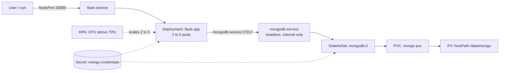

Flask pods are stateless, so there can be several of them behind one Service. MongoDB is the stateful part, so it is a single pod in a StatefulSet with its data on a persistent volume. Both read the same Secret, which means the credentials live in exactly one place.

## Part 1: local setup and the virtual environment question

Part 1 doesn't need to be submitted, but it has a question about virtual environments, so here is my answer.

A virtual environment gives each Python project its own private set of packages. That matters for a few reasons. Two projects can need different versions of the same library without clashing (this assignment pins Flask 2.0.2, which is very different from what a new project would install today). Nothing gets installed into the system Python, so I can't break other tools by accident and I don't need admin rights. `pip freeze` or `requirements.txt` then describes exactly what this project uses, which makes it easy for someone else to reproduce the setup. And if the environment gets messy I can delete the `venv` folder and rebuild it in a minute.

My local Python is 3.14, which is far newer than the pinned library versions (they date from 2021 and 2022). Rather than fight that, I ran the app only inside Docker with `python:3.9-slim`. In a way the container does the same job as a virtual environment, just one level up: the app gets its own isolated Python and its own packages.

## Changes I made to app.py

The assignment asks for the Flask code to authenticate against MongoDB. The original read a single `MONGODB_URI`. I changed it to read the pieces separately from environment variables:

| Variable | Used for | Where it comes from in Kubernetes |
|---|---|---|
| `MONGO_HOST` | Mongo hostname | set to `mongodb-service` in the Deployment |
| `MONGO_PORT` | Mongo port | `27017` in the Deployment |
| `MONGO_USERNAME` | login | `mongo-credentials` Secret |
| `MONGO_PASSWORD` | login | `mongo-credentials` Secret |

Two other small things:

- I pass `username`, `password` and `authSource="admin"` to `MongoClient` as arguments instead of building a URI string. That way a password with special characters doesn't need URL-escaping. `authSource` is `admin` because the root user MongoDB creates on first start lives in the `admin` database.
- On POST, if the body isn't valid JSON the app returns a 400 instead of crashing with a 500.

## Build and push the Docker image

You need a Docker Hub account. Replace `klaus0017` with your own username if you are building it yourself.

```powershell
cd flask-mongodb-app

# build
docker build -t flask-mongodb-app:1.0 .

# log in (Docker Desktop opens a browser window)
docker login

# tag with <username>/<repo>:<tag>, which is what Docker Hub expects
docker tag flask-mongodb-app:1.0 klaus0017/flask-mongodb-app:1.0

# push
docker push klaus0017/flask-mongodb-app:1.0
```

The repository is public, so Minikube can pull it without any credentials. I know that works because my pods pulled it without a pull secret.

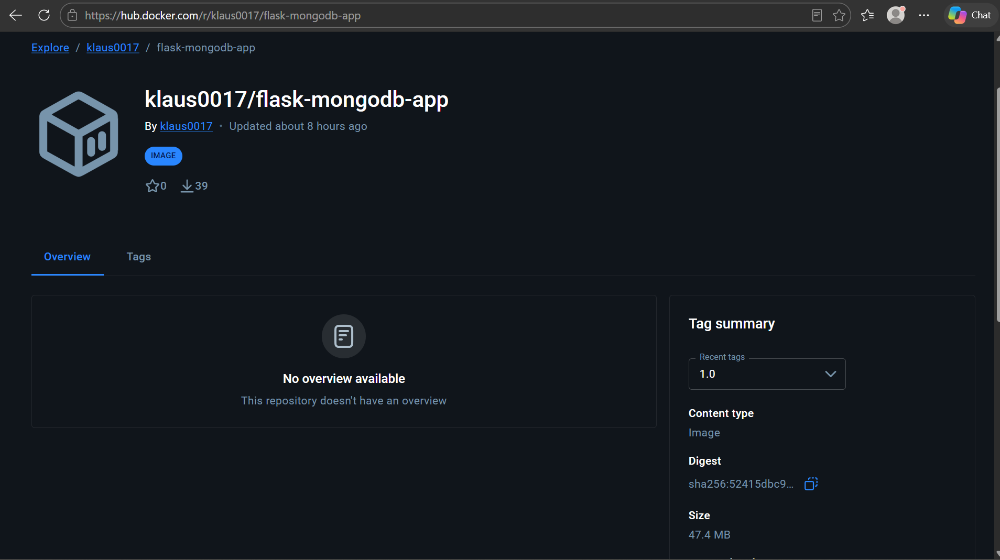

Before moving to Kubernetes I tested the image with plain Docker: a Mongo container started with `MONGO_INITDB_ROOT_USERNAME` and `MONGO_INITDB_ROOT_PASSWORD`, plus the Flask container on a shared Docker network. All three endpoints worked there.

## Deploy on Minikube

### Prerequisites

- Docker Desktop, running (the engine has to be started before anything else works)
- Minikube and kubectl
- The repo cloned and the commands run from its root

```powershell
git clone https://github.com/klaus007p/flask-mongodb-app.git
cd flask-mongodb-app
```

### 1. Start the cluster

```powershell
minikube start --driver=docker
kubectl get nodes
minikube addons enable metrics-server
```

The node should show `Ready`. The metrics-server addon is needed for the autoscaler, because without it the HPA has no CPU numbers to look at.

### 2. Apply the manifests in this order

```powershell
kubectl apply -f k8s/secret.yaml
kubectl apply -f k8s/mongo-pv-pvc.yaml
kubectl apply -f k8s/mongo-service.yaml
kubectl apply -f k8s/mongo-statefulset.yaml
kubectl apply -f k8s/flask-deployment.yaml
kubectl apply -f k8s/flask-service.yaml
kubectl apply -f k8s/flask-hpa.yaml
```

I apply them one by one on purpose. `kubectl apply -f k8s/` would go alphabetically and start the Flask pods before the Secret exists, so they would fail for a few seconds with `CreateContainerConfigError` before recovering. It works out in the end but it looks messy.

### 3. Wait for everything to come up

```powershell
kubectl get pods -w
```

You want `mongodb-0` and two `flask-app` pods at `1/1 Running`, then press Ctrl+C. Check the rest with:

```powershell
kubectl get all
kubectl get pv,pvc
kubectl get hpa
```

`mongo-pv` and `mongo-pvc` should both say `Bound`.

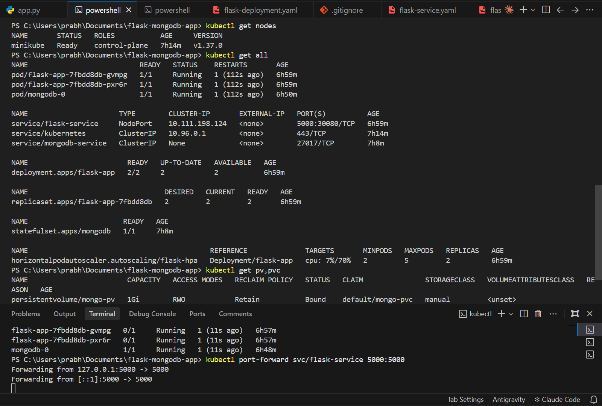

### 4. Reach the app from your machine

With the Docker driver on Windows, the NodePort is not directly reachable from the host, so I used port-forward. Leave this running in its own terminal:

```powershell
kubectl port-forward svc/flask-service 5000:5000
```

Then in a second terminal:

```powershell
Invoke-RestMethod http://localhost:5000/
Invoke-RestMethod -Method Post -Uri http://localhost:5000/data -ContentType "application/json" -Body '{"sampleKey":"sampleValue"}'
Invoke-RestMethod http://localhost:5000/data
```

On Linux or macOS the same requests with curl:

```bash
curl http://localhost:5000/
curl -X POST -H "Content-Type: application/json" -d '{"sampleKey":"sampleValue"}' http://localhost:5000/data
curl http://localhost:5000/data
```

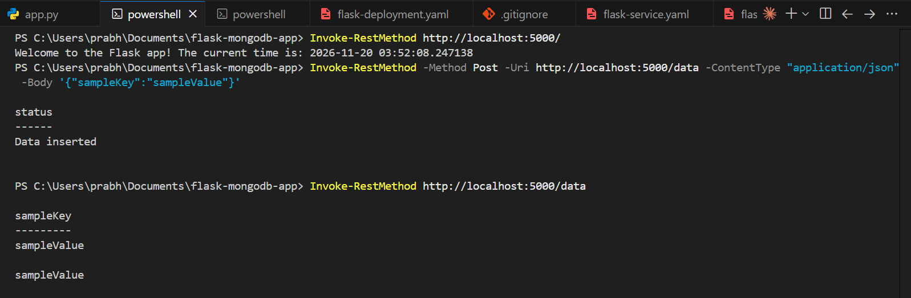

`minikube service flask-service --url` is the other way in, since it goes through the real NodePort Service. It needs its terminal to stay open and prints a different port every time. I tried it first, couldn't connect from PowerShell, and switched to port-forward, so that is what I tested with.

### What each manifest does

| File | What it creates | Notes |
|---|---|---|
| `secret.yaml` | Secret `mongo-credentials` | `username` and `password`, shared by Mongo and Flask |
| `mongo-pv-pvc.yaml` | PV `mongo-pv` (1Gi, hostPath `/data/mongo`) and PVC `mongo-pvc` | both use `storageClassName: manual` so they bind to each other |
| `mongo-service.yaml` | Service `mongodb-service` | `clusterIP: None` (headless), internal only |
| `mongo-statefulset.yaml` | StatefulSet `mongodb`, 1 replica, `mongo:7.0` | auth turned on through the Secret, data mounted at `/data/db` |
| `flask-deployment.yaml` | Deployment `flask-app`, 2 replicas | env vars from the Secret, requests/limits, readiness probe on `/` |
| `flask-service.yaml` | Service `flask-service`, NodePort 30080 | exposes Flask outside the cluster |
| `flask-hpa.yaml` | HPA `flask-hpa` | 2 to 5 replicas, target 70% CPU |

### How MongoDB authentication is switched on

The official `mongo` image enables authentication when you give it `MONGO_INITDB_ROOT_USERNAME` and `MONGO_INITDB_ROOT_PASSWORD`. The StatefulSet reads both from the Secret with `secretKeyRef`. One thing to know: the user is only created the first time the container starts with an empty data directory. If you change the password in the Secret later, nothing happens until you wipe the volume.

## How DNS resolution works in the cluster

Pods don't talk to each other by IP, because pod IPs change every time a pod is recreated. Kubernetes runs an internal DNS server (CoreDNS) and every pod is automatically configured to use it. In my cluster it was at `10.96.0.10`, which is the `kube-dns` Service.

Every Service gets a DNS name in the form:

```
<service-name>.<namespace>.svc.cluster.local
```

so my MongoDB Service is `mongodb-service.default.svc.cluster.local`. Each pod's `/etc/resolv.conf` also has search domains (`default.svc.cluster.local`, `svc.cluster.local`, `cluster.local`). That is why a pod in the same namespace can just say `mongodb-service` and the resolver expands it to the full name. This is also why `nslookup` printed some `NXDOMAIN` lines in my test. It tries the short name against each search domain in turn, the wrong ones fail, and the right one answers.

What comes back depends on the type of Service. A normal ClusterIP Service returns one virtual IP, and kube-proxy spreads traffic across the pods behind it. A headless Service (`clusterIP: None`, which is what I used for Mongo) returns the pod IPs directly. My test returned `10.244.0.2`, which is the IP of `mongodb-0`. StatefulSet pods also get their own stable name, `mongodb-0.mongodb-service`.

So the connection from Flask to Mongo is configured like this: the Deployment sets `MONGO_HOST=mongodb-service`, the app passes that host plus the credentials from the Secret to `MongoClient`, and CoreDNS turns the name into the pod's current IP.

```powershell
kubectl get svc
kubectl run dns-test --rm -it --image=busybox:1.36 --restart=Never -- nslookup mongodb-service.default.svc.cluster.local
```

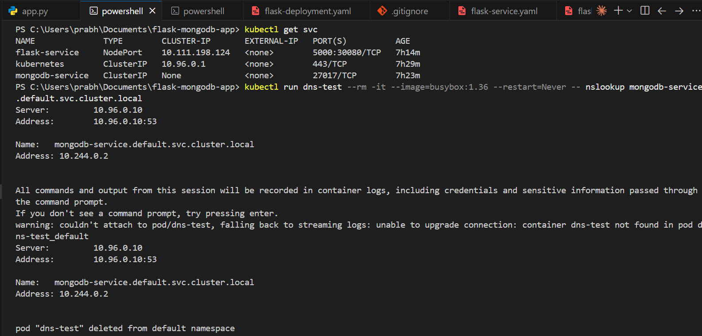

## Resource requests and limits

Both the Flask and MongoDB containers use the values from the assignment:

```yaml
resources:
  requests:
    cpu: 200m      # 0.2 CPU
    memory: 250M
  limits:
    cpu: 500m      # 0.5 CPU
    memory: 500M
```

A request is the amount Kubernetes reserves for the container. The scheduler only places a pod on a node that has that much unreserved, so requests are what keep a node from being overcommitted. A limit is the ceiling. The two resources behave differently when a container goes over the limit: CPU is throttled (the container slows down), but memory can't be throttled, so the container is killed with `OOMKilled` and restarted.

Having both is useful. Requests give each pod a guaranteed minimum and help placement, limits stop one misbehaving pod from starving the rest of the node. Because my requests are lower than my limits, the pods run in the Burstable QoS class, which means they can use spare capacity but are first in line to be evicted if the node runs out.

Requests also matter for autoscaling. The HPA measures CPU as a percentage of the request, not of the node or the limit. With a 200m request, 70% means about 140m per pod, and that is exactly what `kubectl describe hpa` showed me (`70% (140m) / 70%`). Without a CPU request the HPA can't work at all.

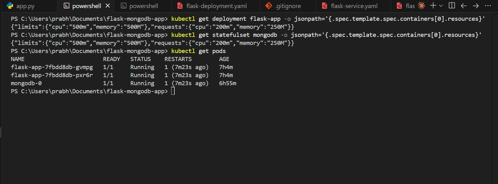

## Design choices

| Decision | What I chose | What else I considered | Why I went with mine |
|---|---|---|---|
| Flask workload | Deployment | Bare pods | A Deployment replaces dead pods, supports rolling updates and works with the HPA |
| Mongo workload | StatefulSet | Deployment | Stable pod name and storage identity, which is what a database needs. The assignment asks for a StatefulSet anyway |
| Mongo replicas | 1 | 3-node replica set | Two Mongo pods sharing one volume would fight over the same data files, and two with separate volumes would just be two unrelated databases. A real replica set needs `rs.initiate()`, keyfile auth and more config, which is out of scope here. It would be the next step for high availability |
| Mongo Service | Headless ClusterIP | NodePort or LoadBalancer | Mongo must only be reachable inside the cluster. Headless also gives the StatefulSet pod a stable DNS name |
| Flask Service | NodePort | LoadBalancer, Ingress | The simplest thing that is reachable from outside on Minikube. Ingress felt like overkill for one app |
| Storage | PV (hostPath) + PVC | emptyDir, dynamic provisioning | emptyDir loses data when the pod goes away. Minikube can provision volumes dynamically, but the task asks for an explicit PV and PVC, so I wrote them by hand |
| PVC use in StatefulSet | Reference the existing PVC | `volumeClaimTemplates` | Templates create one PVC per replica, which is the better pattern if you scale Mongo. With one replica and a hand-written PV, referencing the PVC directly is simpler. It would not work for more than one replica |
| Credentials | Secret, injected as env vars | Hardcoding, ConfigMap | Passwords shouldn't be in the image or in plain config |
| Autoscaling | HPA on CPU at 70% | Manual scaling | It's the requirement, and it reacts without anyone watching |
| Flask base image | `python:3.9-slim` | full `python` image, newer Python | Small image and it matches the old pinned libraries. 3.9 is end of life, so for real use I would upgrade Flask and pymongo and move to a current Python |
| Mongo image tag | `mongo:7.0` | `latest` | A pinned tag means the same deployment every time |
| Readiness probe | HTTP GET `/` | none | Traffic only goes to pods that answer. `/` doesn't touch Mongo, so a database hiccup doesn't mark every Flask pod unready |
| Cluster access | `kubectl port-forward` | `minikube service` | Worked reliably with the Docker driver on Windows |

## Testing scenarios

All tests were run against the cluster described above, with the port-forward on `localhost:5000`.

### 1. Application and database interaction

I posted a document, then read it back.

```powershell
Invoke-RestMethod -Method Post -Uri http://localhost:5000/data -ContentType "application/json" -Body '{"sampleKey":"sampleValue"}'
Invoke-RestMethod http://localhost:5000/data
```

Result: `status: Data inserted` and the document came back on the GET (screenshot in step 4 of the deploy section).

### 2. MongoDB authentication

```powershell
kubectl exec mongodb-0 -- mongosh -u admin -p secret123 --authenticationDatabase admin --eval "db.runCommand({ping:1})"
kubectl exec mongodb-0 -- mongosh --eval "db.adminCommand('listDatabases')"
```

Result: the first returned `{ ok: 1 }`. The second, without credentials, failed with `MongoServerError: Command listDatabases requires authentication`. So authentication is really enforced.

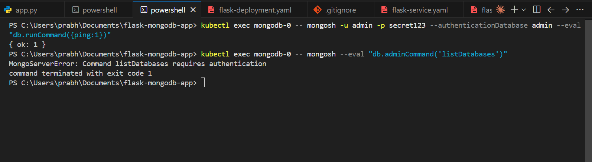

### 3. Load balancing across the Flask pods

I sent 10 requests to `/data` through the Service from a temporary pod, then looked at which pod logged them. The readiness probe also hits `/` every few seconds, so I filtered for `/data` only.
```powershell
kubectl run curl-test --rm -it --image=busybox:1.36 --restart=Never -- sh -c 'for i in 1 2 3 4 5 6 7 8 9 10; do wget -q -O- http://flask-service:5000/data > /dev/null; done'
kubectl logs -l app=flask-app --prefix --tail=30 | Select-String "GET /data"
```

Result: the requests showed up in the logs of both Flask pods, so the Service is spreading traffic.

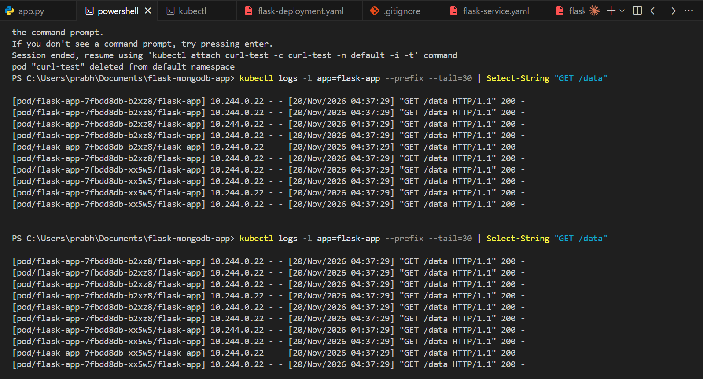

### 4. Self-healing

I deleted one Flask pod and watched.

```powershell
$pod = kubectl get pods -l app=flask-app -o jsonpath='{.items[0].metadata.name}'
kubectl delete pod $pod
kubectl get pods -w
```

Result: the old pod went to `Terminating` and the Deployment started a replacement straight away. It was `1/1 Running` about 11 seconds later and the count went back to 2.

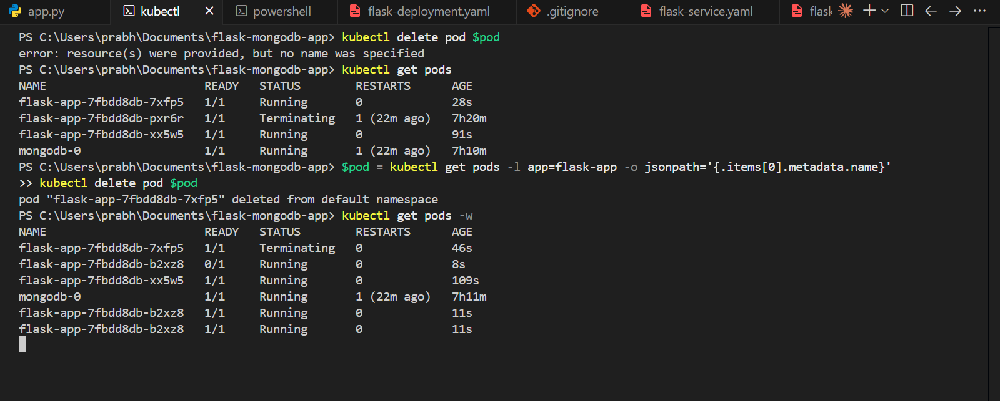

### 5. Data persistence

I added a marker document, deleted the MongoDB pod, waited for the StatefulSet to bring it back, and read the data again.

```powershell
Invoke-RestMethod -Method Post -Uri http://localhost:5000/data -ContentType "application/json" -Body '{"test":"persistence"}'
Invoke-RestMethod http://localhost:5000/data | ConvertTo-Json
kubectl delete pod mongodb-0
kubectl get pods -w
Invoke-RestMethod http://localhost:5000/data | ConvertTo-Json
```

Result: the new `mongodb-0` came up and all 5 documents were still there, including the `test: persistence` ones. The data lives on the PV, not inside the pod. (I used `ConvertTo-Json` because PowerShell's default table output only shows the columns of the first document and hides the rest.)

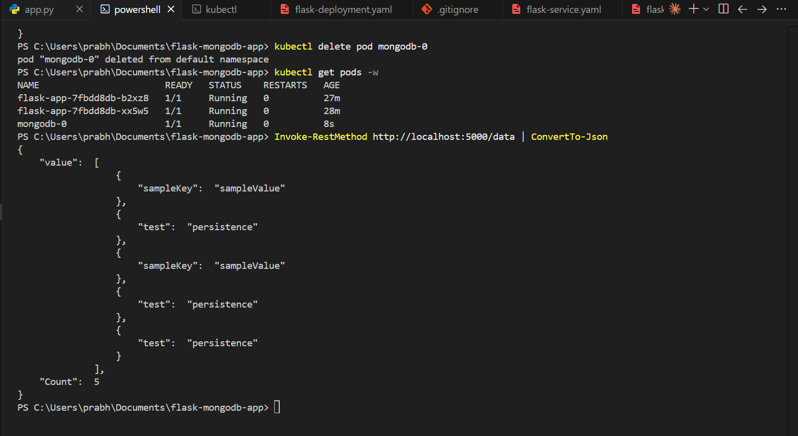

### 6. Autoscaling under high traffic

I simulated traffic by running busybox pods that call the Flask Service in an endless loop, and watched the HPA and the pods in two other terminals.

```powershell
# terminal 1
kubectl get hpa flask-hpa -w

# terminal 2
kubectl get pods -w

# terminal 3: start the load
kubectl run load-generator   --image=busybox:1.36 --restart=Never -- /bin/sh -c "while true; do wget -q -O- http://flask-service:5000/ > /dev/null; done"
kubectl run load-generator-2 --image=busybox:1.36 --restart=Never -- /bin/sh -c "while true; do wget -q -O- http://flask-service:5000/ > /dev/null; done"
kubectl run load-generator-3 --image=busybox:1.36 --restart=Never -- /bin/sh -c "while true; do wget -q -O- http://flask-service:5000/ > /dev/null; done"

# stop the load
kubectl delete pod load-generator load-generator-2 load-generator-3
```

I ran the test twice.

| Run | Load | CPU reached | Replicas | Notes |
|---|---|---|---|---|
| 1 | 2 generators, about 2.5 minutes | 109% of request | 2 → 3 | the new pod was ready about 12 seconds after it was created. I stopped the load while CPU was still high, so it never got to 5 |
| 2 | 3 generators, left running until CPU settled | 137% of request | 2 → 4 | scaled within about a minute of the load starting, CPU settled around 70% once there were 4 pods |

The jump from 2 straight to 4 in the second run follows from the HPA formula, `desired = ceil(current × utilization / target)`, which here is `ceil(2 × 137 / 70) = ceil(3.9) = 4`.

After I removed the load, CPU dropped to about 1% almost immediately, but the replicas stayed at 4 for a while and were back at 2 roughly 7 minutes later. That is the HPA's scale-down stabilization window (5 minutes by default) at work. It scales up quickly and down slowly on purpose, so it doesn't flap.

`kubectl describe hpa flask-hpa` shows the decisions it made:

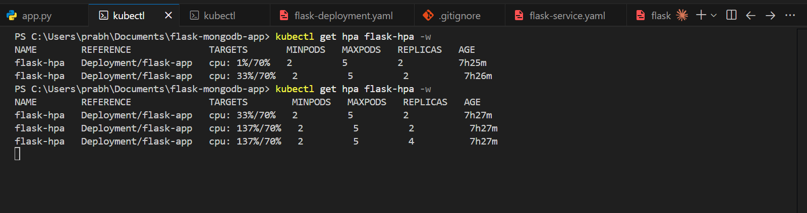

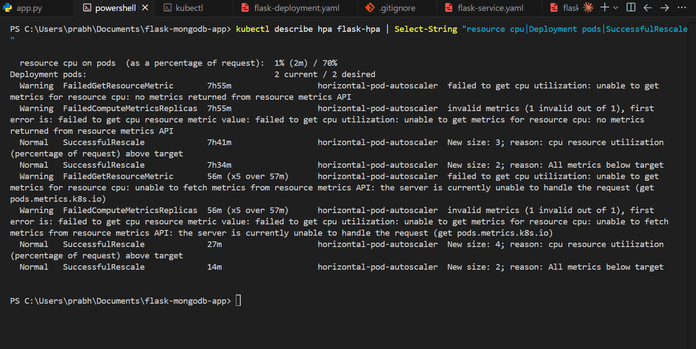

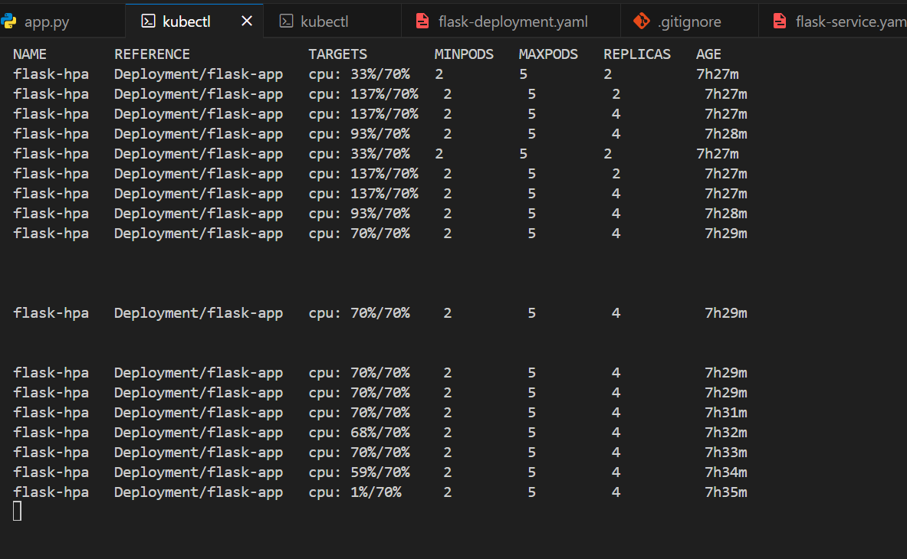

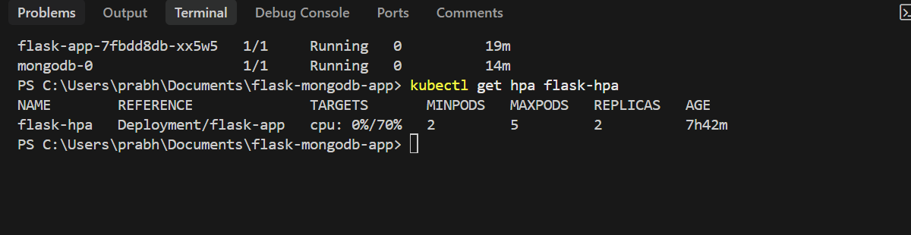

## Issues I ran into

These are the real problems I hit, in the order they happened.

1. **`failed to connect to the docker API`.** Docker Desktop simply wasn't running. Docker, Minikube and kubectl all depend on the engine, so I now start Docker Desktop first and wait for "Engine running".
2. **`COPY requires at least two arguments`.** I had typed `COPY requirements.txt` in the Dockerfile and left out the destination `.`.
3. **`SyntaxError` in the container.** I had written `if __name__ = "__main__":` with one `=` instead of `==`. A Docker image is a snapshot, so the fix only took effect after I rebuilt the image, and the rebuilt one is what I pushed. Otherwise Kubernetes would have pulled the broken one.
4. **Couldn't connect through `minikube service --url`.** With the Docker driver on Windows the NodePort isn't reachable from the host directly. I switched to `kubectl port-forward`.
5. **`Unable to connect to the server ... connection refused` the next morning.** After a restart `minikube status` showed everything `Stopped`. Running `minikube start` brought the cluster back with the deployments and the MongoDB data intact. If this happens to you, start Docker Desktop first, then `minikube start`.
6. **HPA warnings in the events.** `kubectl describe hpa` listed `FailedGetResourceMetric` events ("no metrics returned", "did not receive metrics for targeted pods"). They showed up right after the HPA was first created and again right after the cluster restart. metrics-server needs a minute or two to start reporting, and the HPA recovered on its own both times.
7. **Load generator pods ended in `Error`.** That is just the exit code when an endless loop gets killed by `kubectl delete`. Not a real problem.

## Cleanup

```powershell
kubectl delete -f k8s/
minikube stop        # pauses the cluster, keeps everything
minikube delete      # removes the cluster and its data
```

If you reuse a cluster after deleting the StatefulSet and want fresh credentials, also clear the old data first: `minikube ssh "sudo rm -rf /data/mongo/*"`.

## Limitations

- `secret.yaml` has a demo password in it. That is fine for an assignment, but real credentials shouldn't be committed. In a real setup I would create the Secret with `kubectl create secret` or use an external secrets manager. Also remember a Secret is only base64 encoded, not encrypted.
- MongoDB runs as one pod, so it is not highly available. A replica set would be the next step.
- The PV uses `hostPath`, which lives on the Minikube node and is only good for local development.
- Python 3.9 and the pinned library versions are old. They are what the assignment specified, but a real project should move to current versions.